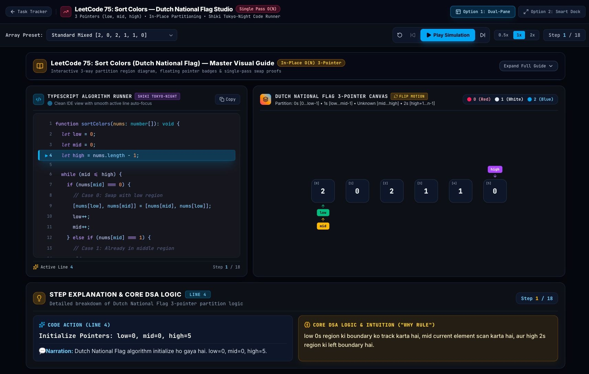

# DSA Visualizer Studio

Explore algorithms step by step with animated states, highlighted TypeScript code and explanations in Hindi and English.



[Source](https://github.com/Kkknight-12/dsa-visualizer-test) · [Local studio after starting Next.js](http://localhost:3000/)

Captured from published Sort Colors with its guide collapsed on 12 October 2026. A hosted demo URL has not been verified.

## Available routes

These routes exist in public source and were included in the production build:

| Studio | Local route |
| --- | --- |
| Sort Colors / Dutch National Flag | [/sort-colors](http://localhost:3000/sort-colors) |
| Maximum Subarray / Kadane | [/kadanes](http://localhost:3000/kadanes) |
| Search in Rotated Sorted Array | [/search-rotated-array](http://localhost:3000/search-rotated-array) |
| Trapping Rain Water | [/trapping-water](http://localhost:3000/trapping-water) |
| Next Permutation | [/next-permutation](http://localhost:3000/next-permutation) |
| 3Sum | [/3sum](http://localhost:3000/3sum) |
| Binary Tree Postorder Traversal | [/postorder](http://localhost:3000/postorder) |
| Experimental postorder 3D view | [/postorder-3d](http://localhost:3000/postorder-3d) |
| Problem and progress tracker | [/tracker](http://localhost:3000/tracker) |

Home links to a subset of the studios; use direct routes for the others. The tracker's roadmap includes planned work as well as implemented routes.

## Run locally

Use npm and a supported Node release. **Node 22.13+** within the Node 22 line satisfies the stricter engine requirement in the locked lint dependency tree. Next.js itself requires Node 20.9+. The root package declares no engine.

```bash
git clone https://github.com/Kkknight-12/dsa-visualizer-test.git
cd dsa-visualizer-test
npm ci
npm run dev -- --hostname 127.0.0.1 --port 3000
```

Open [the studio](http://localhost:3000/). Development/build may need internet access for Inter and JetBrains Mono, configured with `next/font/google` in [app/layout.tsx](app/layout.tsx).

```bash
npm run lint
npx --no-install tsc --noEmit
npm run build
npm run start -- --hostname 127.0.0.1 --port 3000
```

`start` serves the production build after `build`. Stop a server with Ctrl+C before reusing its port. There is no `test` script or automated algorithm/playback suite.

## Try a simulation

Open Sort Colors, choose a preset, then use **Next Step** to compare pointer positions with the active code line and explanation. Use **Previous Step**, **Reset Simulation**, **Play Simulation** and speed controls to explore. Expand the guide for examples, intuition, proofs and complexity.

Array studios primarily use 2D/SVG and Framer Motion. Postorder also has an experimental Three.js route. The tracker stores completion statuses in this browser's localStorage; cross-device synchronization is not implemented.

## Source map

- [app/](app/): route pages, layout and styles.
- [lib/sortColorsSimulation.ts](lib/sortColorsSimulation.ts) and other `lib/*Simulation.ts` modules: presets and step records with snapshots, pointers, active lines and narration.
- [components/common/ReorderableArrayRail.tsx](components/common/ReorderableArrayRail.tsx): shared animated array rendering with persistent element IDs.
- [components/](components/): guides, code runners, explanations, trees and canvas experiments.
- [lib/store/useSimulationStore.ts](lib/store/useSimulationStore.ts): shared scenario/playback state for components using it. Several algorithm pages use local playback state.
- [lib/trackerData.ts](lib/trackerData.ts): tracker content and route references.

To extend a studio, inspect its step types and preset generator, then the page, code runner and explanation panel. Preserve snapshots and stable IDs. Validate algorithm/playback behavior before presenting another route as complete.

## Verification and limits

On 12 October 2026, commit `f550768` installed, passed `tsc --noEmit`, and passed `npm run build`. The build generated the listed routes. The production server rendered `/sort-colors` in Chrome; the screenshot establishes page loading, not full algorithm or playback correctness.

`npm run lint` failed with **38 existing errors and 134 warnings**. Installation on this Mac's Node 22.12.0 warned that a nested `eslint-visitor-keys` package requires Node 22.13+ in the Node 22 line. Use the prerequisite above for a fresh setup. Automated algorithm/playback correctness and physical-device performance are not established.

Built with Next.js, React, TypeScript, Tailwind CSS, Framer Motion, Shiki and Zustand. Three.js and React Three Fiber support the 3D components. This draft adds no project license.
